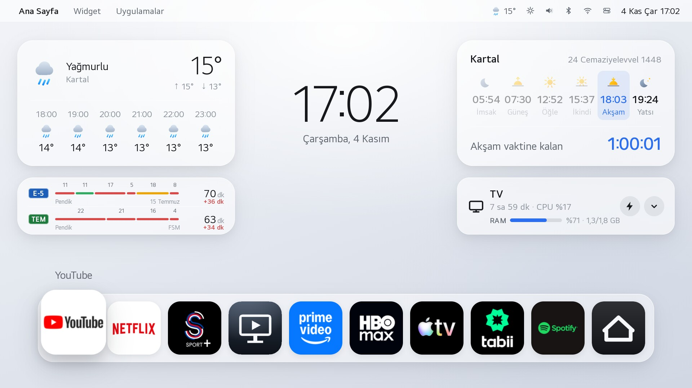
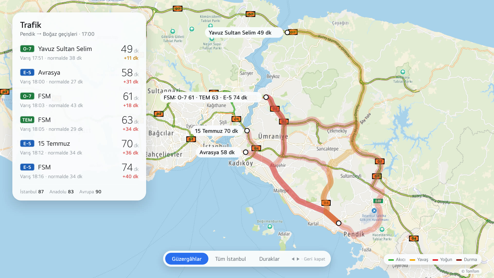
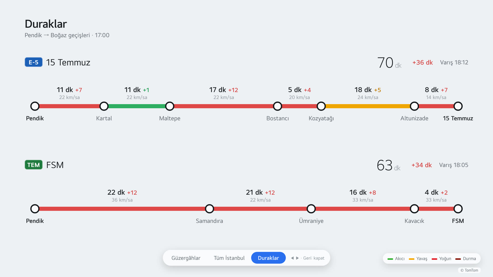
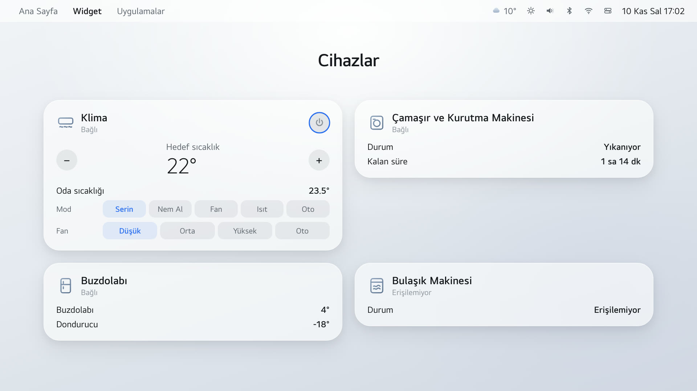
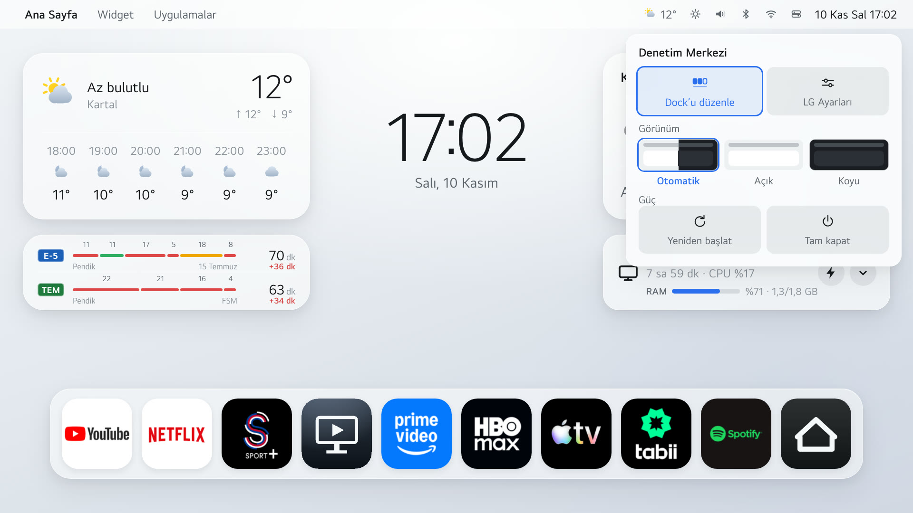

# Sade — LG webOS için sade bir ana ekran

Rootlu LG TV'nin reklamlı ana ekranının yerine geçen hızlı bir launcher.
Yalnızca kullandığınız uygulamaları ve seçtiğiniz widget'ları gösterir:
hava durumu, namaz vakitleri, LG ThinQ cihazlarınız, TV'nin durumu ve
daha fazlası. HOME tuşuna basınca LG'nin ekranı yerine Sade açılır.

https://github.com/user-attachments/assets/34441b90-d8f1-405e-9722-3930fab6229e

**Sürüm 2.20.0** · Kurulum: **[KURULUM.md](KURULUM.md)** (sıfırdan root,
zaten rootlu TV için kısa yol, eski sürümden güncelleme)

```bash
git clone https://github.com/bilalkan/webos-sade && cd webos-sade
```

Hazır paket: **[Releases](https://github.com/bilalkan/webos-sade/releases/latest)**
(`.ipk`, `bash araclar/kur.sh <dosya>` ile kurulur). İçindeki konum örnek
ayardır (İstanbul); kendi konumunuz için `sade/yapilandirma.js`'i düzenleyip
`bash araclar/paketle.sh` ile kendiniz paketleyin.



*Gerçek TV ekranı (LG OLED55B16LA). Yerleşim, widget'lar ve dock kumandayla değiştirilebilir.*

| | |
|:---:|:---:|
|  |  |
| **Güzergâhlar**: seçtiğiniz yollar canlı trafikle | **Duraklar**: hangi parçada ne kadar kaybettiğiniz |
|  |  |
| **Cihazlar**: LG ThinQ, kumandadan | **Denetim Merkezi**: dock, tema, güç |

*Bu dört görüntü TV'de değil, bilgisayarda aynı kodla 1920×1080 çizildi. Trafik
TV'nin gerçek bir okumasından, cihazlar örnek veri.*

## Neler var

| | |
|---|---|
| **Kendi ana ekranı** | HOME tuşu LG Home yerine Sade'yi açar |
| **Widget galerisi** | Solda ve sağda 3'er satır, saatin altında 1 satırlık orta alan. Hangi widget'ın nerede duracağını kumandayla seçersiniz. Hava durumu ve namaz vakitlerinin 2 satırlık büyük ve 1 satırlık küçük hâli var |
| **Hava durumu** | 5 modelin ortalaması (Open-Meteo; cevap vermezse MET Norway): şu an, günün en yüksek ve en düşüğü, sonraki 6 saat. Son veri saklanır, açılışta ağ gecikse de kutu boş kalmaz |
| **Namaz vakitleri** | Diyanet hesabı, sonraki vakte geri sayım. Ayın takvimi bir kerede alınıp saklanır; ay içinde ağ gerekmez |
| **LG ThinQ cihazları** | Klima (aç/kapa, sıcaklık, mod), çamaşır makinesi, buzdolabı, bulaşık makinesi. Evde olmayan cihazın widget'ı görünmez, yer kaplamaz |
| **TV durumu** | RAM, CPU, açık uygulamalar; arka plandakileri tek tuşla kapatma |
| **Ekran süresi · Uyku · Film modu** | Bugün TV'de ne kadar süre, neyin izlendiği; uyku zamanlayıcısı; tek tuşla sinema görüntü/ses modu |
| **Piyasalar · Trafik** | Altın, gümüş, döviz, BIST 100; İstanbul trafik endeksi |
| **Yol durumu** | Seçtiğiniz güzergâhlarda canlı trafikle süre ve gecikme, tam ekran harita. Köprü ya da tünel kapanınca (maraton, bakım) "Kapalı" yazar. İsteğe bağlı, kendi ücretsiz TomTom anahtarınızla ([belgeler/TOMTOM.md](belgeler/TOMTOM.md)) |
| **Menü çubuğu** | Saat, hava, ses, Bluetooth, Wi-Fi, parlaklık, Denetim Merkezi |
| **Güç** | Denetim Merkezi'nden yeniden başlatma ya da tam kapatma. Quick Start+ açıkken TV hiç soğuk açılmadığı için saatler içinde bellek ve takas birikir; tam kapatma bunu sıfırlar |
| **Uygulamalar** | TV'de yüklü olanlar simgeleriyle kendiliğinden gelir; dock'u siz düzenlersiniz |
| **Tema** | Açık, koyu ya da gün doğumu/batımına göre otomatik |
| **Alexa ve spor alarmı** | Ana ekrandan kaldırılabilir |
| **Açılışta Sade** | TV açılınca canlı yayın yerine Sade gelebilir |

Menü çubuğu, TV durumu, ekran süresi, uyku, film modu, güç, piyasalar, trafik,
yol durumu ve yüklü uygulama listesi **root servisi** ile çalışır (KURULUM 7. adım).
Servis yoksa bu parçalar gizlenir; çalışmayan düğme gösterilmez.

## Bilmeniz gerekenler

- **Soğuk açılış yaklaşık 25 saniye sürer.** Bu yalnızca gerçek yeniden
  başlatmada ya da elektrik kesintisinde olur. TV'nin web motoru 21. saniyede
  başlıyor, Sade 25. saniyede açılıyor; Sade'nin kendi payı yarım saniyenin
  altında (ölçüldü). Daha erkene çekmek LG'nin imzalı dosyalarına dokunmayı
  gerektirir. Günlük kullanımda Quick Start+ sayesinde Sade neredeyse anında
  gelir.
- **Geliştirici modu gider.** Kalıcı root için LG Dev Mode uygulaması
  kaldırılır. Sonrasında uygulama kurma ve güncelleme yalnızca root SSH ile
  yapılır; `araclar/kur.sh` bunu yapar.
- **Yazılım güncellemeleri kapatılır.** Güncelleme root'u siler.
- **Garanti etkilenebilir.** Resmî olmayan bir değişiklik yapıyorsunuz.
- **Bazı widget'lar bölgeye özel.** Namaz vakitleri Diyanet hesabıyla gelir
  (`yapilandirma.js`'ten değiştirilebilir). Piyasalar Türkiye, trafik endeksi
  İstanbul içindir. Piyasa verisinin kaynağı (finans.truncgil.com) resmî
  değildir.

## Nereden başlanır

1. **[GUVENLIK.md](GUVENLIK.md)**: önce bunu okuyun. Hangi adımın geri
   dönüşü yok, neyi kaybedersiniz, nasıl geri alınır.
2. **[KURULUM.md](KURULUM.md)**: adım adım kurulum.
   - **[belgeler/ROOT.md](belgeler/ROOT.md)**: kalıcı root (5. adımın
     ayrıntısı)
   - **[belgeler/TOMTOM.md](belgeler/TOMTOM.md)**: trafik için ücretsiz
     anahtar (isteğe bağlı)
3. **[CLAUDE-PROMPT.md](CLAUDE-PROMPT.md)**: kurulumu Claude'a yaptırmak
   isterseniz bu dosyanın içeriğini ona verin.

## Denendiği donanım

```
LG OLED55B16LA · webOS 6.5.3 · firmware 03.53.45 · Chromium 79 · ARM 32-bit
```

Bir TV'de daha yalnızca uyumluluk ölçümü yapıldı: Sade'nin kullandığı 16 sistem
çağrısının hepsi çalışıyor, ama Sade 2.x bu TV'ye kurulmadı.

```
LG 55NANO766QA · webOS 7.6.0 (TV Lite) · firmware 04.60.91 · Chromium 87
node 12 · aarch64 çekirdek, 32-bit kullanıcı alanı · 1,2 GB RAM · slopbro ile root
```

Launcher yalnızca bir web uygulaması olduğu için webOS 5 ve üstünde çalışmalı.
Root ve HOME tuşu kısmı webOS 6.x için yazıldı; başka sürümde root yöntemi
farklıdır. webOS'u lisansla kullanan başka markaların TV'leri (webOS Hub)
denenmedi.

## Paketin içindekiler

```
ayarlar.yerel.ornek.sh  ← kopyalayıp düzenleyin: cp ... ayarlar.yerel.sh
                          (IP, MAC, HOME kodu, TomTom anahtarı; git'e girmez)
ayarlar.sh              varsayılanlar ve açıklamalar; servisin TV'ye ne kadar
                          karışacağı (varsayılan: hiç)
sade/                   launcher (webOS uygulaması)
  yapilandirma.js       ← konum, namaz yöntemi; isteğe bağlı ilk yerleşim,
                          uygulama listesi, dock, tema
servis/                 HOME tuşunu yakalayan ve köprüyü sunan root servisi
  test/                 birim testler (node ile çalışır, TV gerekmez)
araclar/
  tv-ip.sh              TV'yi MAC adresinden bulur (IP değişse de)
  paketle.sh            launcher'dan .ipk üretir (ares gerekmez)
  root-ssh.sh           TV'de komut çalıştırır
  kur.sh                launcher'ı kurar, sürümü doğrular
  servis-kur.sh         servisi kurar, açılış kancasını bağlar
  servis-yeniden.sh     servisi güvenle yeniden başlatır
  root/
    hazirla.sh          slopbro'nun kalıcılık koşusunu anahtarınızla hazırlar
    kalicilik.sh        TV'de root olarak çalışan kalıcılık betiği
    dogrula.sh          kalıcı root kontrolü (yalnızca okur)
    gizle.sh            Alexa ve spor alarmını gizler (önce önizler)
belgeler/
  ROOT.md               kalıcı root, adım adım
  TOMTOM.md             trafik anahtarı
  NASIL-CALISIYOR.md    mekanizma notları
  guzergah-ornek.json   örnek güzergâhlar (İstanbul, altı Boğaz geçişi)
  ekran.jpg             README'deki ekran görüntüsü (gerçek TV)
  guzergah.jpg, duraklar.jpg, cihazlar.jpg, denetim-merkezi.jpg
                        README'deki diğer görüntüler (bilgisayarda çizildi)
```

## Lisans ve kaynaklar

Bu paketteki kod MIT lisanslıdır ([LICENSE](LICENSE)). slopbro pakette yok,
kendiniz klonluyorsunuz. Yararlanılan işler:

- [webosbrew/Homebrew Channel](https://github.com/webosbrew/webos-homebrew-channel): kalıcılık altyapısı
- [throwaway96/slopbro](https://github.com/throwaway96/slopbro): webOS 6 root yöntemi
- [hbertsch/lgtv-webos-root-launcher](https://github.com/hbertsch/lgtv-webos-root-launcher): HOME tuşunu devralma yöntemi
- [Open-Meteo](https://open-meteo.com/) · [MET Norway](https://api.met.no/) (yedek) · [Aladhan](https://aladhan.com/prayer-times-api): hava ve namaz verisi
- [finans.truncgil.com](https://finans.truncgil.com/) (resmî değil) · [İBB](https://api.ibb.gov.tr/): piyasa ve trafik verisi
- [TomTom](https://developer.tomtom.com/) Routing · Traffic Incidents · Map Display: yol süresi, kapanmalar, harita

Uygulama simgeleri pakette dağıtılmaz; TV'nin kendi kayıtlarından okunur.
